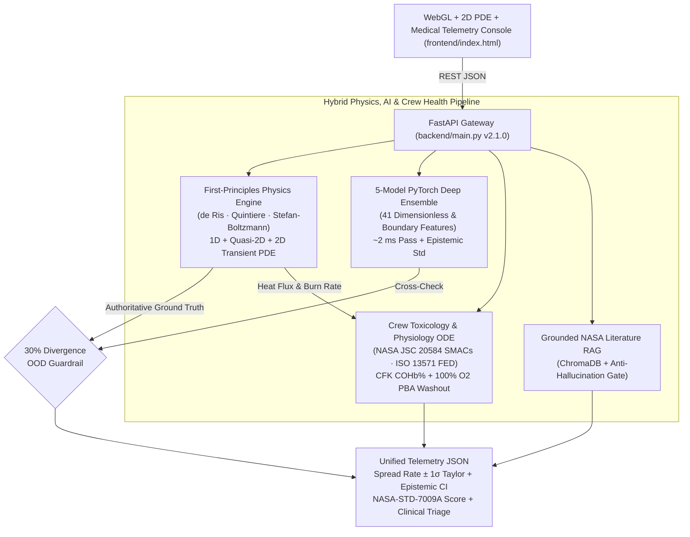

<div align="center">


# Ashes of Microgravity
### Flight-Calibrated Combustion Physics, 2D PDE Solver & Spacecraft Crew Toxicology Lab

**Fire does not rise in orbit. Without buoyancy, it creeps spherically, starves of oxygen, and fills closed habitats with invisible toxicants.**  
*Simulate flame spread, cabin gas buildup, and astronaut physiological risk across ISS (0g), Moon (0.16g), Mars (0.38g), and Earth (1g).*

[Repository](https://github.com/satyam46inv137/ashes-of-microgravity) · [Interactive API (`/docs`)](#-api-reference) · [Constants Audit (`constants_provenance.json`)](ai/constants_provenance.json) · [Attribution (`NOTICE`)](NOTICE)

</div>

---

## Why We Built This

Earth-based fire safety assumes hot gases rise. Twenty thousand years of intuition, building codes, and terrestrial flammability tests depend on buoyant plumes pulling fresh oxygen into the base of a flame.

Inside a spacecraft (`g < 0.01 g0`), that mechanism disappears:

1. **Spherical Diffusion Flames:** Hot combustion products stagnate around the fuel, forming a dim blue sphere governed entirely by molecular diffusion and forced cabin ventilation (`5 to 20 cm/s`).
2. **Ground Screening Misleads:** Removing buoyant convective cooling lowers the Limiting Oxygen Index (LOI) of many polymers in orbit compared to terrestrial `NASA-STD-6001B` chambers.
3. **Smoke Kills Faster Than Heat:** In a sealed module (`106 m³` ISS Destiny or `9.3 m³` Orion capsule), oxygen-starved microgravity flames shift toward incomplete combustion, doubling Carbon Monoxide (`CO`) and sub-micron soot yields while releasing `HCN`, `HCl`, and `HF` from aerospace polymers.

Full 3D reacting CFD takes hours per run and rarely models downstream crew physiology. **Ashes of Microgravity** couples first-principles flame spread physics with a 2D thermal-pyrolysis PDE solver, a 41-feature neural surrogate, and a dynamic NASA SMAC crew toxicology model so mission engineers and flight surgeons can evaluate both **material flammability** and **human survivability** in milliseconds.

---

## System Overview

| Module | Implementation | Core Capability |
| :--- | :--- | :--- |
| **1D & Quasi-2D Physics** | `backend/fire_model.py` | Coupled boundary-layer heat transfer (`de Ris` / `Quintiere`), Stefan-Boltzmann radiative cooling, char insulation, lateral `O₂` entrainment on narrow sheets (`BASS-II`), and clamped-edge conductive quenching. |
| **2D Transient PDE Solver** | `FireModel.simulate_2d()` | NumPy Cartesian thermal-pyrolysis grid solver with automatic Fourier CFL sub-stepping (`Fo <= 0.20`), resolving parabolic (clamped) vs. concave (free-edge) flame fronts. |
| **Crew Toxicology & Triage** | `backend/toxicology.py` | 1-minute cabin mass-balance ODE with `ECLSS` scrubber decay, `SFPE/Tewarson` species yields, `ISO 13571` Purser Fractional Effective Dose (`FED`) with `CO₂` hyperventilation, `CFK` Carboxyhemoglobin (`COHb%`) uptake, and `100% O₂` PBA mask washout. |
| **41-D Neural Surrogate** | `ai/surrogate.py` | 5-member `SiLU` PyTorch deep ensemble trained on 35,000 stratified multi-gravity points (~2 ms inference) gated by a 30% Out-of-Distribution (`OOD`) physics guardrail. |
| **Grounded Literature RAG** | `ai/rag.py` | `ChromaDB` vector store (3,426 chunks from NASA Saffire, BASS-II, and SoFIE reports) with cosine-distance filtering (`<= 1.4`) and offline keyword fallback. |

### Architecture Flow



---

## Flight Validation & Scientific Rigor

We calibrated and benchmarked the physics engine against **13 published microgravity experiments** from **NASA Saffire I–V** and **BASS-II**:

| Validation Tier | Flight Runs (`n`) | In-Sample MAPE | `R²` | Out-of-Sample LOO MAPE | Experimental Regime |
| :--- | :---: | :---: | :---: | :---: | :--- |
| **Core Envelope** | 5 | **2.83%** | **1.000** | **4.15%** | Saffire-I, II, V (`0g`, `101.3 kPa`, `21% O₂`, wide plates) |
| **Extended Regimes** | 8 | **7.83%** | **0.988** | — | High strain (`25 cm/s`), near-LOI (`26% O₂`), low-P (`55 kPa`), narrow sheets (`50 mm`), PMMA rods |
| **Combined Headline** | **13** | **5.90%** | **0.993** | **6.68%** | Full flight dataset (`±17.68%` 95th-percentile LOO error band, covering 12 of 13 runs) |

<details>
<summary><b>View All 13 Flight Telemetry Benchmarks & Transparent Exclusions</b></summary>

<br>

| Mission / Sample | Material | Test Condition | Flight Actual (mm/s) | Model Pred (mm/s) | Error | Tier |
| :--- | :--- | :--- | :---: | :---: | :---: | :---: |
| **Saffire-I S1** | SIBAL Fabric | Concurrent, `20 cm/s`, `0.33 mm` | `0.224` | `0.221` | `-1.3%` | Core |
| **Saffire-I S2** | SIBAL Fabric | Opposed, `20 cm/s`, `0.33 mm` | `1.343` | `1.341` | `-0.1%` | Core |
| **Saffire-II S8** | PMMA Slab | Opposed, `20 cm/s`, `10 mm` | `0.048` | `0.048` | `0.0%` | Core |
| **Saffire-II S7** | PMMA Slab | Opposed, `15 cm/s`, `10 mm` | `0.038` | `0.041` | `+7.9%` | Core |
| **Saffire-V S6** | PMMA Slab | Opposed, `5 cm/s`, `10 mm` | `0.021` | `0.022` | `+4.8%` | Core |
| **Saffire-III S1** | SIBAL Fabric | Concurrent, `25 cm/s`, `0.33 mm` | `0.285` | `0.280` | `-1.8%` | Extended |
| **Saffire-III S2** | SIBAL Fabric | Opposed, `25 cm/s`, `0.33 mm` | `1.480` | `1.500` | `+1.4%` | Extended |
| **Saffire-IV S2** | Nomex HT9040 | Opposed, `26% O₂` (near-LOI) | `0.410` | `0.403` | `-1.7%` | Extended |
| **Saffire-V S4** | PMMA Slab | Opposed, `55 kPa`, `28% O₂`, `5 mm` | `0.075` | `0.061` | `-18.7%` | Extended |
| **BASS-II B1** | SIBAL Fabric | Opposed, `3 cm/s`, `50 mm` narrow | `0.920` | `0.778` | `-15.4%` | Extended |
| **BASS-II B2** | SIBAL Fabric | Opposed, `5 cm/s`, `18% O₂`, `50 mm` | `0.760` | `0.808` | `+6.3%` | Extended |
| **BASS-II B5** | PMMA Rod | Opposed, `6.35 mm` dia, `4.5 cm/s` | `0.052` | `0.056` | `+7.7%` | Extended |
| **BASS-II B9** | PMMA Rod | Opposed, `9.50 mm` dia, `1.5 cm/s` | `0.031` | `0.028` | `-9.7%` | Extended |

**Excluded Runs (`ai/calibration_data_1d.csv`):**
* **`MIST_04` (`preliminary`):** SoFIE-MIST `0.80 mm` PMMA sheet (`0.115 mm/s` actual vs. `0.045 mm/s` predicted, `60.9%` error), held out pending final NASA NTRS data release.
* **`B_FLIGHT_12` (`known_limitation`):** Thick-branch ultra-low-flow boundary (`2.0 cm/s`, `1.2 mm` PMMA, `25.0%` error), documented as a reduced-order thick-regime boundary limitation.

*Calibration note: The 13 flight runs calibrate the physical coefficients. A 
13-point Leave-One-Out (LOO) cross-validation refits 4 global calibration 
parameters (`L_PH_THIN_BASELINE_M`, `F_CONCURRENT_THIN_MICROG`, 
`STRAIN_EXPONENT_THICK`, `RAD_LOSS_COEFF_MICROG`) within each fold. However, 
several empirical parameters (`ROD_CURVATURE_*`, `LOW_P_RAD_FEEDBACK_EXP`, 
`THERMAL_DEPTH_*`, `THIN_THICK_RATIO_*`) were tuned on the full 13-point dataset 
and remain fixed across LOO folds. Consequently, the reported LOO errors may be 
optimistic for these parameters and should not be interpreted as fully 
leakage-free out-of-sample estimates. A fully nested LOO evaluation (all 
data-fitted parameters refit per fold) is planned post-hackathon.*

</details>

*Uncertainty semantics: `flame_spread_uncertainty_mms` is a first-order Taylor 
propagation of input measurement tolerances (±1.5% O₂, ±5% flow, ±2% thickness, 
±1% pressure) plus an applicability-scaled epistemic term (18% inside envelope, 
up to 43% outside). The surrogate's `ensemble_disagreement` is the standard 
deviation across 5 models — an epistemic proxy, not a calibrated 95% CI. Neither 
includes systematic physics error.*

### Constant Provenance (`NASA-STD-7009A`)

Every coefficient in the codebase is logged in [`ai/constants_provenance.json`](ai/constants_provenance.json) with its derivation, confidence tier, and literature citation. For example, `F_CONCURRENT_THIN_MICROG = 0.165` comes directly from the ratio of Saffire-I concurrent (`0.224 mm/s`) to opposed (`1.343 mm/s`) spread over identical SIBAL fabric under `20 cm/s` flow (`0.224 / 1.343 = 0.1668`).

---

## Spacecraft Crew Toxicology & Clinical Triage (`backend/toxicology.py`)

In closed habitats, fire suppression is only half the emergency. Even a slow or self-extinguishing smolder event releases pyrolytic gases that accumulate without gravitational convection:

* **Microgravity Incomplete Combustion:** Oxygen-starved diffusion flames increase `CO` and sub-micron soot yields by **2.1x** compared to well-ventilated 1g burns.
* **SFPE / Tewarson Species Mapping:** Maps 118 materials (with exact SFPE Handbook Table 3-4.14 yields for `SIBAL`, `PMMA`, `Nomex 450`, `Kapton`, `PVC`, `PTFE`, `Polyurethane`, `FR-4`, `Nylon 6`, `ABS`, `Polystyrene`, and `PEEK`) to `CO`, `HCN`, `HCl`, `HF`, `NO₂`, `CO₂`, and particulate soot.
* **Dynamic Cabin ODE & ECLSS Decay:** Integrates minute-by-minute concentration buildup across standard spacecraft volumes (`106 m³` ISS Destiny, `9.3 m³` Orion/Dragon, `60 m³` Lunar Gateway HALO, `250 m³` Mars Transit) with active vs. isolated `ECLSS` air scrubbing (`1.8 ACH`).
* **Physiological Uptake & Countermeasures:**
  * **ISO 13571 Purser FED:** Tracks cumulative asphyxiant dose (`CO + HCN`) amplified by `CO₂`-induced respiratory hyperventilation alongside instantaneous acid-gas irritancy (`HCl`, `HF`, `NO₂`).
  * **CFK Carboxyhemoglobin (`COHb%`) & PBA Washout:** Models blood `COHb%` across crew workload states (`resting`, `light_work`, `emergency`) and simulates accelerated clearance (`t₁/₂ = 74 min` vs. `320 min` ambient) once the crew dons a 100% `O₂` Portable Breathing Apparatus (`PBA`).
  * **Clinical Decision Support:** Flags pulse-oximetry (`SpO₂`) false-normal blindspots during `CO` exposure, recommends `Hydroxocobalamin` over nitrites for mixed `HCN + CO` toxicity, and alerts for delayed `HCl/HF` pulmonary edema.

---

## Uncertainty Quantification & Guardrails

Every prediction reports two independent uncertainty bounds alongside an applicability score:

1. **First-Order Taylor Propagation (Kline & McClintock, 1953):** Propagates sensor tolerances (`O₂ ±1.5%`, `flow ±5.0%`, `thickness ±2.0%`, `pressure ±1.0%`) through central finite differences plus an applicability-scaled epistemic term (`18%` inside envelope up to `43%` outside).
2. **Ensemble Epistemic Disagreement:** Standard deviation (`1.96σ` band) across the 5 neural surrogate members.
3. **30% OOD Guardrail:** If the neural surrogate diverges by `>30%` from the analytical physics engine on any query, it is tagged `OUT_OF_DISTRIBUTION` and the physics engine remains authoritative.

---

## Materials Database (118 Aerospace & Engineering Fuels)

Covers **10 categories**: Commodity Polymers, Engineering Thermosets (`Kapton`, `Epoxy`, `Phenolic`), High-Performance Thermoplastics (`PEEK`, `PTFE`, `PVDF`), Engineering Elastomers, Fabrics & Textiles (`SIBAL`, `Nomex 450`, `Kevlar 29`, `Cotton`), Foams & Insulation, Wood & Bio-materials, Composites & Laminates (`CFRP`, `GFRP`, `FR-4`), Flammable Liquids & Fuels, and Combustible Metals & Solids (`Li`, `Mg`, `Ti`, `Zr`, wax, coal, leather).

Each entry carries `ρ_s`, `c_s`, `k_s`, `T_pyro`, `L_v`, `ΔH_c`, `LOI`, `UL-94`, `E_a`, hemispherical emissivity `ε`, and `LOI_microg_factor`.

---

## Quick Start

### Local Setup

```bash
git clone [https://github.com/satyam46inv137/ashes-of-microgravity.git](https://github.com/satyam46inv137/ashes-of-microgravity.git)
cd ashes-of-microgravity

pip install -r requirements.txt

# Optional: enables Groq synthesis in the RAG tab (offline extractive fallback works without it)
cp .env.example .env

python -m uvicorn backend.main:app --reload --port 8000
# Lab UI:       http://localhost:8000
# Swagger Docs: http://localhost:8000/docs
```

*(On Windows, double-click `run.bat` to load `.env`, start FastAPI, and open the browser automatically.)*

### Docker

```bash
docker build -t ashes-of-microgravity .
docker run -p 7860:7860 -e GROQ_API_KEY=your_key ashes-of-microgravity
# Open http://localhost:7860
```

### Verification & Calibration Suite

```bash
# Run all 49 physics, Quasi-2D, 2D PDE, toxicology, and API verification tests
python -m pytest -v

# Reproduce Saffire / BASS-II calibration & Leave-One-Out validation tables
python -m ai.calibrate_constants
python -m ai.loo_validation
```

---

## API Reference (`backend/main.py` v2.1.0)

| Method | Endpoint | Description |
| :--- | :--- | :--- |
| `GET` | `/health` | Readiness status for physics engine, 118 materials, PyTorch ensemble, and RAG index |
| `GET` | `/materials` | Full 118-material thermophysical database (`?category=` filter supported) |
| `GET` | `/metadata` | Live flight validation summary and full `NASA-STD-7009A` constant provenance |
| `POST` | `/predict` | 1D / Quasi-2D steady-state spread rate, Taylor uncertainty, AI cross-check, and crew toxicology |
| `POST` | `/toxicology` | Standalone dynamic cabin gas ODE, NASA `SMAC` breach timers, `COHb%`, and `Purser FED` curve |
| `POST` | `/simulate-2d` | NumPy 2D transient thermal-pyrolysis PDE solver with spatial temperature snapshots |
| `POST` | `/compare-materials` | Multi-material ranking combining flame spread rate and 10-minute cabin toxicity hazard |
| `POST` | `/sensitivity` | Local One-at-a-Time (`OAT`) finite-difference parameter sensitivity ranking |
| `POST` | `/transient` | 1D energy-conserving burn-through and thickness regression simulation |
| `POST` | `/rag` | Citation-grounded Q&A over ingested NASA microgravity combustion reports |
| `POST` | `/insight` | Physics- and toxicology-grounded safety diagnostics and suppression guidance |

---

<details>
<summary><b>Governing Equations & Primary Literature References</b></summary>

<br>

### Equations

* **Effective Flame Temperature:** $T_{\text{eff}} = T_\infty + (T_{\max} - T_\infty)\left(\frac{X_{O_2}}{0.21}\right)^{0.42}\left(1 - e^{-1.2(P/P_{\text{ref}})^{0.25}}\right)$
* **Mixed-Convection Velocity:** $V_{\text{buoy}} = \sqrt{2 g x_{\text{ref}} \frac{T_{\text{eff}} - T_\infty}{T_\infty}}, \quad V_{\text{eff}} = \sqrt{V_{\text{forced}}^2 + V_{\text{buoy}}^2}$
* **Surface Heat Balance:** $q_{\text{net}} = \frac{k_g (T_{\text{eff}} - T_{\text{pyro}})}{\delta_f} - q_{\text{gas,rad}} + q_{\text{rad,feedback}}, \quad q_{\text{surf,loss}} = \varepsilon \sigma (T_{\text{pyro}}^4 - T_\infty^4)$
* **de Ris Flame Spread:** $V_{f,\text{thin}} = \frac{q_{\text{net}} L_{\text{ph}}}{\rho_s c_s \tau (T_{\text{pyro}} - T_\infty)}, \quad V_{f,\text{thick}} = \frac{q_{\text{net}}^2 L_{\text{ph}}}{k_{\text{eff}} \rho_s c_s (T_{\text{pyro}} - T_\infty)^2}$
* **2D Solid-Phase PDE:** $\rho_s c_s \tau(x,y) \frac{\partial T}{\partial t} = k_s \tau(x,y) \nabla^2 T + Q_{\text{flame}}(x,y) - Q_{\text{rad,surf}}(x,y)$
* **Cabin Toxicology ODE:** $\frac{dC_i}{dt} = \frac{\dot{m}_{\text{fuel}} y_i}{V_{\text{cabin}}} - \lambda_{\text{ECLSS}} C_i$

### Key References

1. **de Ris, J. N. (1969).** "Spread of a laminar diffusion flame." *Proceedings of the Combustion Institute*, 12(1), 241–252.
2. **Fernandez-Pello, A. C., & Hirano, T. (1983).** "Controlling mechanisms of flame spread." *Combustion Science and Technology*, 32(1–4), 1–31.
3. **Olson, S. L., Ferkul, P. V., & T'ien, J. S. (1988).** "Near-limit flame spread over a thin solid fuel in microgravity." *Symposium (International) on Combustion*, 22(1), 1213–1222.
4. **Bhattacharjee, S., Altenkirch, R. A., & Sacksteder, K. (1996).** "The effect of ambient pressure on flame spread over thin cellulosic fuels in a quiescent, microgravity environment." *ASME J. Heat Transfer*, 118(1), 181–190.
5. **Jomaas, G., Torero, J. L., Eigenbrod, C., et al. (2015).** "Fire safety in space — beyond flammability testing of small samples." *Acta Astronautica*, 109, 208–216.
6. **Olson, S. L., Ferkul, P. V., et al. (2019).** "Flame spread: Effects of microgravity and scale." *Combustion and Flame*, 199, 168–182.
7. **Quintiere, J. G. (2006).** *Fundamentals of Fire Phenomena*. John Wiley & Sons.
8. **Tewarson, A. (2002).** "Generation of Heat and Chemical Compounds in Fires." *SFPE Handbook of Fire Protection Engineering* (3rd ed.), Ch. 3–4.
9. **NASA JSC 20584.** *Spacecraft Maximum Allowable Concentrations for Airborne Contaminants (SMACs)*.
10. **ISO 13571.** *Life-threatening components of fire — Guidelines for the estimation of time to compromised tenability in fires*.
11. **Weaver, L. K. (2009).** "Carbon Monoxide Poisoning." *New England Journal of Medicine*, 360(12), 1217–1225.
12. **NASA-STD-6001B** & **NASA-STD-7009A** — Flammability Testing and Models & Simulations Credibility Standards.

</details>

<details>
<summary><b>Known Limitations & Scope</b></summary>

<br>

* **Reduced-Order Physics, Not 3D CFD:** Solves 1D/Quasi-2D analytical balances and a 2D solid-phase thermal PDE rather than full 3D Navier-Stokes reacting flow. It screens materials rapidly but does not replace `NASA-STD-6001B` hardware certification.
* **Flight-Validated Subset:** Only 3 of the 118 materials (`SIBAL`, `PMMA`, `Nomex 450`) have direct microgravity flight telemetry in our calibration set. Other materials extrapolate from published thermophysical constants and carry explicit `MEDIUM` or `LOW` applicability scores.
* **Single-Point Regimes:** Sub-atmospheric radiative feedback (`55 kPa`, Saffire-V S4, `18.7%` error) and near-LOI damping (`26% O₂`, Saffire-IV S2) are calibrated to single flight runs and carry wider uncertainty bands.
* **Well-Mixed Cabin Assumption:** The toxicology ODE models uniform cabin mixing; localized concentration pockets near avionics racks before ventilation mixing are not spatially resolved.

</details>

<details>
<summary><b>Repository Structure</b></summary>

<br>

```text
ashes-of-microgravity/
├── backend/
│   ├── main.py                    # FastAPI v2.1.0, Pydantic contracts, 11 endpoints
│   ├── fire_model.py              # 1D, Quasi-2D, transient, & 2D thermal-pyrolysis PDE solver
│   ├── toxicology.py              # NASA SMACs, ISO 13571 FED, CFK COHb%, & PBA washout engine
│   └── materials.py               # 118-material thermophysical & combustion database
├── ai/
│   ├── surrogate.py               # 41-feature 5-model PyTorch SiLU ensemble
│   ├── train_surrogate.py         # Stratified multi-gravity training pipeline
│   ├── calibrate_constants.py     # Saffire / BASS-II calibration verification report
│   ├── loo_validation.py          # Leave-one-out cross-validation script
│   ├── insights.py                # Physics & crew-toxicology diagnostic rules
│   ├── rag.py                     # ChromaDB + Groq grounded literature assistant
│   ├── calibration_data_1d.csv    # 13 flight benchmarks + 2 documented exclusions
│   ├── constants_provenance.json  # Audited constant provenance & citations
│   └── models/                    # Trained ensemble weights (.pt) & scalers (.npz)
├── frontend/
│   ├── index.html                 # Interactive WebGL, 2D PDE, & Medical Telemetry Lab
│   └── audio/                     # Narrated 30-second walkthrough audio & captions
├── tests/
│   └── test_fire_model.py         # 44 physics, Quasi-2D, 2D PDE, & API tests
|   └── test_toxicology.py         # 5 crew toxicology, SMAC, & FED kinetics tests
├── Dockerfile
├── docker-compose.yml
├── requirements.txt
├── run.bat
├── LICENSE
└── NOTICE
```

</details>

---

## Team & Attribution

Built for **NASA International Space Apps Challenge 2026 — *Flame in Freefall***:

* **Satyam Sharma** *(B.Tech CSE — Data Science)*: Combustion physics modeling, 2D thermal-pyrolysis PDE solver, 41-feature PyTorch ensemble, FastAPI architecture, and frontend engineering.
* **Shivam Sharma** *(MBBS — Clinical Medicine)*: Spacecraft crew toxicology modeling, NASA JSC 20584 SMAC integration, ISO 13571 Purser FED & CFK carboxyhemoglobin kinetics, and clinical triage protocols.

Licensed under the **Apache License 2.0** — see [`LICENSE`](LICENSE) and [`NOTICE`](NOTICE) for attribution terms.