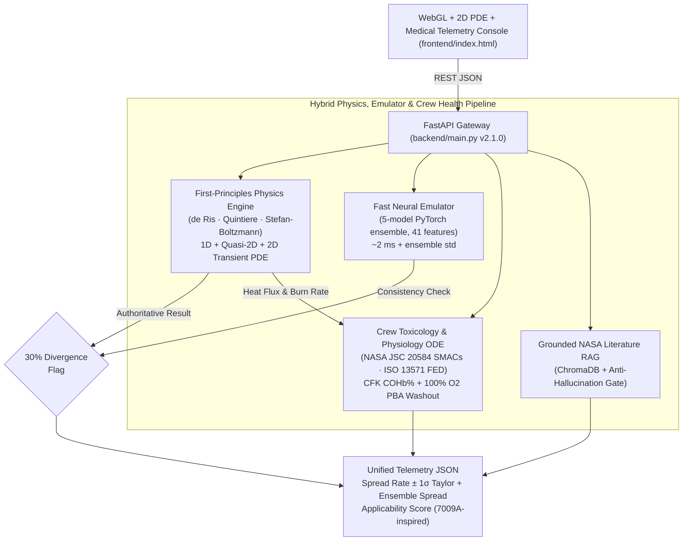

<div align="center">


# Ashes of Microgravity
### Flight-Calibrated Combustion Physics, 2D PDE Solver & Spacecraft Crew Toxicology Lab

**Fire does not rise in orbit. Without buoyancy, it creeps spherically, starves of oxygen, and can fill closed habitats with invisible toxicants.**  
*Screen flame spread, cabin gas buildup, and crew physiological risk across ISS (0g), Moon (0.16g), Mars (0.38g), and Earth (1g).*

[Repository](https://github.com/satyam46inv137/ashes-of-microgravity) · [Interactive API (`/docs`)](#api-reference-backendmainpy-v210) · [Constants Audit (`constants_provenance.json`)](ai/constants_provenance.json) · [Attribution (`NOTICE`)](NOTICE)

</div>

---

## TL;DR

- **What:** a fast *screening* tool for material flammability and cabin toxicity in microgravity, with a FastAPI backend and an interactive web lab.
- **How:** a reduced-order flame-spread model (de Ris / Quintiere), a 2D thermal-pyrolysis PDE solver, and a cabin toxicology ODE (ISO 13571 FED, COHb kinetics).
- **Calibration:** 5 NASA Saffire missions (I–V) + BASS-II, **13 flight runs** in total.
- **Honest accuracy:** in-sample MAPE is **5.90%**; under a *fully nested* leave-one-out test (16 fitted constants refit per fold) it is **10.4-12.3%** over 3 seeds.
- **Neural surrogate:** a fast emulator of the physics model (~2 ms), not an independent validator. The physics engine is always authoritative.

> **Disclaimer.** This is a research and educational project built for a hackathon. It is **not** a medical device, **not** clinical guidance, and **not** a substitute for `NASA-STD-6001B` hardware certification or any qualified safety/medical review. It is not affiliated with or endorsed by NASA. The toxicology and "clinical decision support" outputs illustrate published models and must not be used to make real treatment or safety decisions.

<!-- TODO: add a 10-15 s demo GIF here, e.g. docs/demo.gif
<p align="center"></p>
-->

---

## Why We Built This

Earth-based fire safety assumes hot gases rise. Building codes and terrestrial flammability tests rely on buoyant plumes pulling fresh oxygen into the base of a flame.

Inside a spacecraft (`g < 0.01 g0`), that mechanism disappears:

1. **Spherical Diffusion Flames:** Hot combustion products stagnate around the fuel, forming a dim blue sphere governed by molecular diffusion and forced cabin ventilation (`5 to 20 cm/s`).
2. **Ground Screening Can Mislead:** Removing buoyant convective cooling can lower the Limiting Oxygen Index (LOI) of many polymers in orbit compared to terrestrial `NASA-STD-6001B` chambers.
3. **Smoke and Toxic Gases Can Dominate the Hazard:** In a sealed module (`106 m³` ISS Destiny or `9.3 m³` Orion capsule), oxygen-starved flames shift toward incomplete combustion. The model assumes roughly `2.1x` higher `CO` and sub-micron soot yields than well-ventilated 1g burns (an assumed scaling, not a measured flight value), and aerospace polymers can release `HCN`, `HCl`, and `HF`.

Full 3D reacting CFD takes hours per run and rarely models downstream crew physiology. **Ashes of Microgravity** couples first-principles flame spread physics with a 2D thermal-pyrolysis PDE solver, a 41-feature neural surrogate, and a dynamic cabin toxicology model so that engineers and flight surgeons can *screen* both **material flammability** and **crew exposure** in milliseconds.

---

## System Overview

| Module | Implementation | Core Capability |
| :--- | :--- | :--- |
| **1D & Quasi-2D Physics** | `backend/fire_model.py` | Coupled boundary-layer heat transfer (`de Ris` / `Quintiere`), Stefan-Boltzmann radiative cooling, char insulation, lateral `O₂` entrainment on narrow sheets (`BASS-II`), and clamped-edge conductive quenching. |
| **2D Transient PDE Solver** | `FireModel.simulate_2d()` | NumPy Cartesian thermal-pyrolysis grid solver with automatic Fourier CFL sub-stepping (`Fo <= 0.20`), resolving parabolic (clamped) vs. concave (free-edge) flame fronts. |
| **Crew Toxicology** | `backend/toxicology.py` | 1-minute cabin mass-balance ODE with `ECLSS` scrubber decay, `SFPE/Tewarson` species yields, `ISO 13571` Purser Fractional Effective Dose (`FED`) with `CO₂` hyperventilation, `CFK` Carboxyhemoglobin (`COHb%`) uptake, and `100% O₂` PBA mask washout. |
| **41-D Neural Surrogate (emulator)** | `ai/surrogate.py` | 5-member `SiLU` PyTorch deep ensemble trained on 35,000 stratified multi-gravity points (~2 ms inference). It emulates the physics engine; it is **not** independently validated against flight data. A 30% divergence flag marks queries where the emulator and physics disagree. |
| **Grounded Literature RAG** | `ai/rag.py` | `ChromaDB` vector store (3,426 chunks from NASA Saffire, BASS-II, and SoFIE reports) with cosine-distance filtering (`<= 1.4`) and offline keyword fallback. |

### Architecture Flow



---

## Flight Validation & Scientific Rigor

The physics engine is calibrated against **13 microgravity flight runs** from **NASA Saffire I-V** and **BASS-II** (`ai/calibration_data_1d.csv`). Because 13 points is a small dataset, we report accuracy three ways and lead with the strictest one.

### Headline: fully nested validation

In every fold, **all 16 empirical constants are refit from scratch using only the training runs** (`ai/nested_loo.py`). Search ranges are wide and are not centred on the all-data tuned values, and no shrinkage toward any tuned value is applied.

| Evaluation | MAPE | Notes |
| :--- | :---: | :--- |
| In-sample (constants tuned on all 13 runs) | 5.90% | Optimistic by construction |
| **Nested leave-one-out** | **10.4-12.3%** | 3 optimiser seeds; median APE 6.8-11.2%; P95 APE ≈ 27-28% |
| Nested leave-one-mission-out | 8.1-19.9% | **Unstable**: depends on optimiser seed when BASS-II is held out |

Largest nested-LOO errors (seed 0): Saffire-V S4 (38%), BASS-II B5 (21%), BASS-II B9 (17%), and Saffire-III S1 (14%). Leave-one-mission-out is unstable when BASS-II is held out because rod geometry and the narrow-sheet constants are constrained by only a few runs.

**Treat this as a screening-level model.** Further constants are still hand-set in the code and are *not* refit inside the folds (see [Fitted constants vs. data](#fitted-constants-vs-data)), so even the nested numbers remain slightly optimistic.

### In-sample fit by tier

| Tier | Flight Runs (`n`) | In-Sample MAPE | `R²` (in-sample) | Regime |
| :--- | :---: | :---: | :---: | :--- |
| Core Envelope | 5 | 2.83% | 1.000 | Saffire-I, II, V (`0g`, `101.3 kPa`, `21% O₂`, wide plates) |
| Extended Regimes | 8 | 7.83% | 0.988 | High strain (`25 cm/s`), near-LOI (`26% O₂`), low-P (`55 kPa`), narrow sheets (`50 mm`), PMMA rods |
| Combined | **13** | **5.90%** | 0.993 | Full flight dataset |

*`R²` is reported for completeness only. With 5 points and several free constants, an in-sample `R²` near 1 is expected and is not evidence of predictive skill.*

*Precision note: `calibrate_constants.py` reports `5.90%` using 3-decimal-rounded predictions from the public `predict()` API. `ai/nested_loo.py`'s `in_sample_with_tuned_constants` baseline reports `6.03%` using the internal unrounded `flame_spread_mms_raw` field. Both values are correct measures of the same model — the small difference is purely a rounding artifact. The README uses `5.90%` as the user-facing number because it matches the canonical `calibrate_constants.py` output.*

<details>
<summary><b>All 13 flight runs: sources, in-sample vs. nested errors, and exclusions</b></summary>

<br>

| Mission / Sample | Material | Test Condition | Flight Actual (mm/s) | Model Pred, in-sample (mm/s) | In-sample err (signed) | Nested LOO \|err\| (seed 0) | Tier | Source (as recorded in the CSV) |
| :--- | :--- | :--- | :---: | :---: | :---: | :---: | :---: | :--- |
| **Saffire-I S1** | SIBAL Fabric | Concurrent, `20 cm/s`, `0.33 mm` | `0.224` | `0.221` | `-1.3%` | `5.6%` | Core | Olson & Ferkul 2019, Table 1 |
| **Saffire-I S2** | SIBAL Fabric | Opposed, `20 cm/s`, `0.33 mm` | `1.343` | `1.341` | `-0.1%` | `2.5%` | Core | Olson & Ferkul 2019, Table 1 |
| **Saffire-II S8** | PMMA Slab | Opposed, `20 cm/s`, `10 mm` | `0.048` | `0.048` | `0.0%` | `8.4%` | Core | Saffire-II Final Report |
| **Saffire-II S7** | PMMA Slab | Opposed, `15 cm/s`, `10 mm` | `0.038` | `0.041` | `+7.9%` | `6.4%` | Core | Saffire-II multi-flow sweep |
| **Saffire-V S6** | PMMA Slab | Opposed, `5 cm/s`, `10 mm` | `0.021` | `0.022` | `+4.8%` | `2.6%` | Core | Saffire-V (citation to be added) |
| **Saffire-III S1** | SIBAL Fabric | Concurrent, `25 cm/s`, `0.33 mm` | `0.285` | `0.280` | `-1.8%` | `14.4%` | Extended | Saffire-III (citation to be added) |
| **Saffire-III S2** | SIBAL Fabric | Opposed, `25 cm/s`, `0.33 mm` | `1.480` | `1.500` | `+1.4%` | `0.3%` | Extended | Saffire-III (citation to be added) |
| **Saffire-IV S2** | Nomex HT9040* | Opposed, `26% O₂` (near-LOI) | `0.410` | `0.403` | `-1.7%` | `3.3%` | Extended | Urban et al., ICES-2021-125 |
| **Saffire-V S4** | PMMA Slab | Opposed, `55 kPa`, `28% O₂`, `5 mm` | `0.075` | `0.061` | `-18.7%` | `38.1%` | Extended | Ruff et al. 2021 |
| **BASS-II B1** | SIBAL Fabric | Opposed, `3 cm/s`, `50 mm` narrow | `0.920` | `0.778` | `-15.4%` | `7.4%` | Extended | Ferkul et al., BASS-II |
| **BASS-II B2** | SIBAL Fabric | Opposed, `5 cm/s`, `18% O₂`, `50 mm` | `0.760` | `0.808` | `+6.3%` | `11.9%` | Extended | Ferkul et al., BASS-II |
| **BASS-II B5** | PMMA Rod | Opposed, `6.35 mm` dia, `4.5 cm/s` | `0.052` | `0.056` | `+7.7%` | `20.9%` | Extended | BASS-II (citation to be added) |
| **BASS-II B9** | PMMA Rod | Opposed, `9.50 mm` dia, `1.5 cm/s` | `0.031` | `0.028` | `-9.7%` | `16.9%` | Extended | BASS-II (citation to be added) |

\* The Saffire-IV Nomex HT9040 sample is modelled with the database entry for **Nomex 450**, which is a different fabric. This is a known modelling assumption.

*Flight values and sources are transcribed from `ai/calibration_data_1d.csv`; readers should verify them against the cited reports. Rows marked "citation to be added" still need an exact reference.*

**Excluded runs (`ai/calibration_data_1d.csv`):**
* **`MIST_04` (`preliminary`):** SoFIE-MIST `0.80 mm` PMMA sheet (`0.115 mm/s` actual vs. `0.045 mm/s` predicted, `60.9%` error), held out pending final NASA NTRS data release.
* **`B_FLIGHT_12` (`known_limitation`):** Thick-branch ultra-low-flow boundary (`2.0 cm/s`, `1.2 mm` PMMA, `25.0%` error), a documented reduced-order thick-regime limitation.

These two runs are excluded from the metrics above. To include them in the nested validation, run `python -m ai.nested_loo --include-excluded`.

#### Nested validation by optimiser seed

| Seed | LOO MAPE | LOO median APE | LOO P95 APE | LOO max APE | LOMO MAPE |
| :---: | :---: | :---: | :---: | :---: | :---: |
| 0 | 10.67% | 7.38% | 27.79% | 38.07% | 19.94% |
| 100 | 12.26% | 11.19% | 27.95% | 38.68% | 10.19% |
| 200 | 10.42% | 6.83% | 26.88% | 32.76% | 8.07% |

</details>

### Neural surrogate check on the flight runs

`python -m ai.surrogate_flight_check` compares the trained emulator with the physics engine and the flight data on the 13 calibration runs. This is in-sample for the physics constants, so it measures emulator fidelity, not independent validation.

| Comparison | MAPE | Median APE | Max APE |
| :--- | :---: | :---: | :---: |
| Physics vs. flight (in-sample) | 6.03% | 5.91% | 18.4% |
| Surrogate vs. flight | 9.59% | 8.25% | 25.5% |
| Surrogate vs. physics | 5.12% | 2.42% | 26.0% |

On the 11 non-rod runs the surrogate differs from the physics engine by about 2.2% on average (max 4.1%). The two PMMA rods (BASS-II B5, B9) are the weak spot: 16% and 26% from physics, and 25.5% and 14.5% from flight. The ensemble spread is also largest there (about 17% of the mean), so it signals the extra uncertainty. The 26% gap on B9 is still below the 30% divergence flag.

### Fitted constants vs. data

13 flight runs constrain **16 refit constants** (plus further hand-set constants, listed below). Several of the refit constants are not identifiable from this data. Values are from the nested LOO run with optimiser seed 0.

| Constant | Stability across 13 LOO folds (CV) | Folds at search bound | Assessment |
| :--- | :---: | :---: | :--- |
| `L_PH_THIN_BASELINE_M` | 1% | 0% | Well constrained |
| `F_CONCURRENT_THIN_MICROG` | 2% | 0% | Well constrained |
| `RAD_LOSS_COEFF_MICROG` | 1% | 0% | Well constrained |
| `ROD_CURVATURE_BASE` | 14% | 0% | Constrained by 2 rod runs only |
| `ROD_CURVATURE_SLOPE` | 52% | 0% | Poorly constrained |
| `LOW_P_RAD_FEEDBACK_EXP` | 32% | 38% | Single run (Saffire-V S4); unstable when it is held out |
| `THERMAL_DEPTH_COEFF` | 46% | 0% | Poorly constrained |
| `THERMAL_DEPTH_V_EXP` | 22% | 31% | Often at bound; weakly constrained |
| `STRAIN_EXPONENT_THICK` | 35% | 0% | Not exercised: no thick-fuel run has flow above 20 cm/s |
| `THIN_THICK_RATIO_LO` | 65% | 38% | Not identifiable |
| `THIN_THICK_RATIO_HI` | 18% | 15% | Weakly constrained |
| `CONCURRENT_VEL_EXP` | 29% | 0% | Exercised by Saffire-I S1 / Saffire-III S1 only |
| `NARROW_SHEET_EDGE_EXP` | 13% | 0% | Exercised by BASS-II B1, B2 only |
| `LATERAL_O2_ENTRAIN_COEFF` | 49% | 15% | Degenerate with the edge exponent (same two runs) |
| `LOW_FLOW_BOOST_EXP` | 12% | 8% | Exercised by BASS-II B1 only |
| `RAD_FEEDBACK_COEFF` | 28% | 0% | Exercised by Saffire-IV S2, Saffire-V S4 |

Several fold-mean values (seed 0) differ clearly from the hand-tuned defaults: `LOW_P_RAD_FEEDBACK_EXP` ≈ 1.19 vs. 0.45, `THIN_THICK_RATIO_LO` ≈ 0.47 vs. 0.85, `LATERAL_O2_ENTRAIN_COEFF` ≈ 0.51 vs. 0.25, and `LOW_FLOW_BOOST_EXP` ≈ 0.54 vs. 0.15. This shows the data admits more than one parameter set. Treat the poorly constrained constants as curve-fitting knobs, not physical measurements.

**Hand-set constants not refit in the nested folds.** These live in `fire_model.py` / `materials.py`. Some are probably literature-based thresholds and others may have been informed by the flight data; the split is not yet documented per constant (see `ai/constants_provenance.json`). Two of them are not exercised by any calibration run, so they can be neither fitted nor validated: `STRAIN_EXPONENT_THIN = 0.58` (the maximum calibration flow is 25 cm/s) and `SPHERE_CURVATURE_MULT = 1.85` (no spherical-fuel data). The rest are the per-material `LOI_microg_factor` values, the concurrent-flow buoyant-gravity multipliers (`F_CONCURRENT_THIN_BUOYANT`, `F_CONCURRENT_THICK_BUOYANT`), the extinction thresholds (`QUIESCENT_FLOW_CMS`, `FLOW_STRAIN_CRITICAL_CMS`, `FLOW_STRAIN_CRITICAL_THIN_CMS`, `BLOWOFF_FLOW_CMS`), the flame-temperature exponents (`0.42`, `1.2`, `0.25`), and the sub-atmospheric LOI-pressure exponent (`0.12`). `CONCURRENT_VEL_EXP`, `NARROW_SHEET_EDGE_EXP`, `LATERAL_O2_ENTRAIN_COEFF`, `LOW_FLOW_BOOST_EXP`, and `RAD_FEEDBACK_COEFF` were promoted to named constants and **are refit inside every fold** (`PARAM_SPECS` in `ai/nested_loo.py`). Promoting the remaining constants and including them in the nested refit is on the roadmap.

*Uncertainty semantics: `flame_spread_uncertainty_mms` is a first-order Taylor propagation of input measurement tolerances (±1.5% O₂, ±5% flow, ±2% thickness, ±1% pressure) plus an applicability-scaled epistemic term (18% inside the envelope, up to 43% outside). That epistemic term is a heuristic, not a statistically calibrated quantity. The surrogate's `ensemble_disagreement` is the standard deviation across 5 models, an epistemic proxy rather than a calibrated 95% CI. Neither includes systematic physics error.*

### Constant Provenance (aligned with `NASA-STD-7009A` practice)

Every coefficient is logged in [`ai/constants_provenance.json`](ai/constants_provenance.json) with its derivation, confidence tier, and literature citation. For example, `F_CONCURRENT_THIN_MICROG = 0.165` comes from the ratio of Saffire-I concurrent (`0.224 mm/s`) to opposed (`1.343 mm/s`) spread over identical SIBAL fabric under `20 cm/s` flow (`0.224 / 1.343 = 0.1668`). This project follows the *spirit* of `NASA-STD-7009A` (documented provenance, applicability and uncertainty reporting) but makes no claim of compliance with it.

---

## Spacecraft Crew Toxicology (`backend/toxicology.py`)

In closed habitats, fire suppression is only half the emergency. Even a slow or self-extinguishing smolder event releases pyrolytic gases that accumulate without gravitational convection.

> **Validation status:** this module implements published equations (Tewarson/SFPE yields,
> ISO 13571 FED, CFK COHb kinetics) and is verified against:
> - 5 internal-consistency tests (monotonicity, mass balance, mask effect)
> - 3 analytical ODE tests (closed-form cabin mass-balance solution)
> - 4 published-benchmark tests (NASA JSC 20584 SMACs, Weaver 2009 CFK equilibrium,
>   ISO 13571 FED time-scaling, PVC-smolder HCl dominance)
>
> It has **not** been validated against real exposure data. There is no public in-orbit
> crew-exposure data, and terrestrial fire-incident data have not been used to validate
> this module. Outputs remain **illustrative** for
> research and educational use — not clinical decision-making.

* **Microgravity Incomplete Combustion:** the model assumes oxygen-starved diffusion flames raise `CO` and sub-micron soot yields by `2.1x` compared to well-ventilated 1g burns (assumed scaling).
* **SFPE / Tewarson Species Mapping:** Maps 118 materials (with SFPE Handbook Table 3-4.14 yields for `SIBAL`, `PMMA`, `Nomex 450`, `Kapton`, `PVC`, `PTFE`, `Polyurethane`, `FR-4`, `Nylon 6`, `ABS`, `Polystyrene`, and `PEEK`) to `CO`, `HCN`, `HCl`, `HF`, `NO₂`, `CO₂`, and particulate soot.
* **Dynamic Cabin ODE & ECLSS Decay:** Integrates minute-by-minute concentration buildup across standard spacecraft volumes (`106 m³` ISS Destiny, `9.3 m³` Orion/Dragon, `60 m³` Lunar Gateway HALO, `250 m³` Mars Transit) with active vs. isolated `ECLSS` air scrubbing (`1.8 ACH`).
* **Physiological Uptake & Countermeasures (educational):**
  * **ISO 13571 Purser FED:** Tracks cumulative asphyxiant dose (`CO + HCN`) amplified by `CO₂`-induced respiratory hyperventilation alongside instantaneous acid-gas irritancy (`HCl`, `HF`, `NO₂`).
  * **CFK Carboxyhemoglobin (`COHb%`) & PBA Washout:** Models blood `COHb%` across crew workload states (`resting`, `light_work`, `emergency`) and simulates accelerated clearance (`t₁/₂ = 74 min` vs. `320 min` ambient) once the crew dons a 100% `O₂` Portable Breathing Apparatus (`PBA`).
  * **Clinical decision-support concepts:** Flags the pulse-oximetry (`SpO₂`) false-normal blind spot during `CO` exposure, mentions `Hydroxocobalamin` over nitrites for mixed `HCN + CO` toxicity, and alerts for delayed `HCl/HF` pulmonary edema. These are illustrations of published guidance, **not treatment recommendations**.

> **Key physical insight (demonstrated by unit tests):** *Extinct ≠ Safe.* In the model, extinct mode still applies an assumed 0.012 g/s smolder floor (a modelling assumption, not a measured value), so halogenated polymers (PVC) release HCl and trigger CRITICAL triage even with no flame, while low-toxicity materials (PMMA) smolder benignly. Paired tests `test_cohb_stays_low_when_extinct_pmma` and `test_pvc_smolder_is_dangerous_from_hcl` capture this distinction.

---

## Uncertainty Quantification & Guardrails

Every prediction reports two independent uncertainty indicators alongside an applicability score:

1. **First-Order Taylor Propagation (Kline & McClintock, 1953):** Propagates sensor tolerances (`O₂ ±1.5%`, `flow ±5.0%`, `thickness ±2.0%`, `pressure ±1.0%`) through central finite differences, plus a heuristic applicability-scaled epistemic term (`18%` inside the envelope up to `43%` outside).
2. **Ensemble Disagreement:** Standard deviation across the 5 neural-emulator members (reported as a `1.96σ` band; this is an epistemic proxy, not a calibrated 95% interval).
3. **30% Divergence Flag:** If the emulator differs by `>30%` from the analytical physics engine on any query, the result is tagged `OUT_OF_DISTRIBUTION` and the physics engine remains authoritative. Agreement between the emulator and the physics engine is **not** independent validation, because the emulator is trained to reproduce the physics engine.

> If any calibrated physics constant changes, the surrogate must be retrained, since its training data and input features depend on those constants.

The **applicability score** (0-100) measures distance outside the validated flight envelope (gravity, O₂, flow, thickness, pressure, and whether the material is one of the three flight-validated fuels). It is inspired by the credibility factors in `NASA-STD-7009A` but is not an assessment under that standard.

---

## Materials Database (118 Aerospace & Engineering Fuels)

Covers **10 categories**: Commodity Polymers, Engineering Thermosets (`Kapton`, `Epoxy`, `Phenolic`), High-Performance Thermoplastics (`PEEK`, `PTFE`, `PVDF`), Engineering Elastomers, Fabrics & Textiles (`SIBAL`, `Nomex 450`, `Kevlar 29`, `Cotton`), Foams & Insulation, Wood & Bio-materials, Composites & Laminates (`CFRP`, `GFRP`, `FR-4`), Flammable Liquids & Fuels, and Combustible Metals & Solids (`Li`, `Mg`, `Ti`, `Zr`, wax, coal, leather).

Each entry carries `ρ_s`, `c_s`, `k_s`, `T_pyro`, `L_v`, `ΔH_c`, `LOI`, `UL-94`, `E_a`, hemispherical emissivity `ε`, and `LOI_microg_factor`. **Only 3 of the 118 materials (`SIBAL`, `PMMA`, `Nomex 450`) have flight data behind them**; the rest are extrapolations and carry reduced applicability scores.

---

## Quick Start

### Local Setup

```bash
git clone https://github.com/satyam46inv137/ashes-of-microgravity.git
cd ashes-of-microgravity

pip install -r requirements.txt

# Optional: enables Groq synthesis in the RAG tab (offline extractive fallback works without it).
# Never commit your .env file; it is listed in .gitignore.
cp .env.example .env

python -m uvicorn backend.main:app --reload --port 8000
# Lab UI:       http://localhost:8000
# Swagger Docs: http://localhost:8000/docs
```

*(On Windows, double-click `run.bat` to load `.env`, start FastAPI, and open the browser automatically.)*

### Docker

```bash
docker build -t ashes-of-microgravity .
docker run -p 7860:7860 -e GROQ_API_KEY=your_key ashes-of-microgravity
# Open http://localhost:7860
```

### Verification & Calibration Suite

```bash
# Run all 56 physics, Quasi-2D, 2D PDE, toxicology, and API verification tests
python -m pytest -v

# Reproduce the Saffire / BASS-II calibration table
python -m ai.calibrate_constants

# Fully nested leave-one-out and leave-one-mission-out validation (needs scipy; several minutes per seed, depending on CPU cores)
python -m ai.nested_loo --mode both --workers 4 --seed 0
python -m ai.nested_loo --mode both --workers 4 --seed 100 --out ai/nested_s100.json
python -m ai.nested_loo --mode both --workers 4 --seed 200 --out ai/nested_s200.json

# Legacy LOO (only 4 constants refit per fold; optimistic, kept for comparison)
python -m ai.loo_validation

# Neural surrogate vs. physics engine vs. flight data on the calibration runs (needs trained weights + torch)
python -m ai.surrogate_flight_check
```

---

## API Reference (`backend/main.py` v2.1.0)

| Method | Endpoint | Description |
| :--- | :--- | :--- |
| `GET` | `/health` | Readiness status for physics engine, 118 materials, PyTorch ensemble, and RAG index |
| `GET` | `/materials` | Full 118-material thermophysical database (`?category=` filter supported) |
| `GET` | `/metadata` | Live flight validation summary and constant provenance |
| `POST` | `/predict` | 1D / Quasi-2D steady-state spread rate, Taylor uncertainty, emulator cross-check, and crew toxicology |
| `POST` | `/toxicology` | Standalone dynamic cabin gas ODE, `SMAC` breach timers, `COHb%`, and `Purser FED` curve (illustrative) |
| `POST` | `/simulate-2d` | NumPy 2D transient thermal-pyrolysis PDE solver with spatial temperature snapshots |
| `POST` | `/compare-materials` | Multi-material ranking combining flame spread rate and 10-minute cabin toxicity hazard |
| `POST` | `/sensitivity` | Local One-at-a-Time (`OAT`) finite-difference parameter sensitivity ranking |
| `POST` | `/transient` | 1D energy-conserving burn-through and thickness regression simulation |
| `POST` | `/rag` | Citation-grounded Q&A over ingested NASA microgravity combustion reports |
| `POST` | `/insight` | Physics- and toxicology-grounded safety diagnostics and suppression guidance (educational) |

`/predict`, `/toxicology` and `/insight` responses include a `disclaimer` field (research/educational use only).

**Deployment settings (environment variables):**

| Variable | Default | Purpose |
| :--- | :---: | :--- |
| `GROQ_API_KEY` | unset | Enables Groq synthesis in `/rag` (never commit it) |
| `ALLOWED_ORIGINS` | `*` | Comma-separated CORS origins; set explicitly for a real deployment |
| `RATE_LIMIT_PER_MIN` | `120` | Per-IP request limit for all API routes |
| `RATE_LIMIT_HEAVY_PER_MIN` | `20` | Per-IP limit for `/simulate-2d`, `/rag`, `/transient`, `/compare-materials`, `/sensitivity` |
| `TRUST_PROXY_HEADERS` | `0` | Set to `1` behind a reverse proxy to use `X-Forwarded-For` as the client IP |
| `RATE_LIMIT_DISABLED` | `0` | Set to `1` to turn the in-memory limiter off |

The limiter is in-memory and per process; use a shared store (e.g. Redis) if you run multiple workers.

---

<details>
<summary><b>Governing Equations & Primary Literature References</b></summary>

<br>

### Equations

* **Effective Flame Temperature:** $T_{\text{eff}} = T_\infty + (T_{\max} - T_\infty)\left(\frac{X_{O_2}}{0.21}\right)^{0.42}\left(1 - e^{-1.2(P/P_{\text{ref}})^{0.25}}\right)$
* **Mixed-Convection Velocity:** $V_{\text{buoy}} = \sqrt{2 g x_{\text{ref}} \frac{T_{\text{eff}} - T_\infty}{T_\infty}}, \quad V_{\text{eff}} = \sqrt{V_{\text{forced}}^2 + V_{\text{buoy}}^2}$
* **Surface Heat Balance:** $q_{\text{net}} = \frac{k_g (T_{\text{eff}} - T_{\text{pyro}})}{\delta_f} - q_{\text{gas,rad}} + q_{\text{rad,feedback}}, \quad q_{\text{surf,loss}} = \varepsilon \sigma (T_{\text{pyro}}^4 - T_\infty^4)$
* **de Ris Flame Spread:** $V_{f,\text{thin}} = \frac{q_{\text{net}} L_{\text{ph}}}{\rho_s c_s \tau (T_{\text{pyro}} - T_\infty)}, \quad V_{f,\text{thick}} = \frac{q_{\text{net}}^2 L_{\text{ph}}}{k_{\text{eff}} \rho_s c_s (T_{\text{pyro}} - T_\infty)^2}$
* **2D Solid-Phase PDE:** $\rho_s c_s \tau(x,y) \frac{\partial T}{\partial t} = k_s \tau(x,y) \nabla^2 T + Q_{\text{flame}}(x,y) - Q_{\text{rad,surf}}(x,y)$
* **Cabin Toxicology ODE:** $\frac{dC_i}{dt} = \frac{\dot{m}_{\text{fuel}} y_i}{V_{\text{cabin}}} - \lambda_{\text{ECLSS}} C_i$

### Key References

1. **de Ris, J. N. (1969).** "Spread of a laminar diffusion flame." *Proceedings of the Combustion Institute*, 12(1), 241-252.
2. **Fernandez-Pello, A. C., & Hirano, T. (1983).** "Controlling mechanisms of flame spread." *Combustion Science and Technology*, 32(1-4), 1-31.
3. **Olson, S. L., Ferkul, P. V., & T'ien, J. S. (1988).** "Near-limit flame spread over a thin solid fuel in microgravity." *Symposium (International) on Combustion*, 22(1), 1213-1222.
4. **Bhattacharjee, S., Altenkirch, R. A., & Sacksteder, K. (1996).** "The effect of ambient pressure on flame spread over thin cellulosic fuels in a quiescent, microgravity environment." *ASME J. Heat Transfer*, 118(1), 181-190.
5. **Jomaas, G., Torero, J. L., Eigenbrod, C., et al. (2015).** "Fire safety in space - beyond flammability testing of small samples." *Acta Astronautica*, 109, 208-216.
6. **Olson, S. L., Ferkul, P. V., et al. (2019).** "Flame spread: Effects of microgravity and scale." *Combustion and Flame*, 199, 168-182.
7. **Quintiere, J. G. (2006).** *Fundamentals of Fire Phenomena*. John Wiley & Sons.
8. **Tewarson, A. (2002).** "Generation of Heat and Chemical Compounds in Fires." *SFPE Handbook of Fire Protection Engineering* (3rd ed.), Ch. 3-4.
9. **NASA JSC 20584.** *Spacecraft Maximum Allowable Concentrations for Airborne Contaminants (SMACs)*.
10. **ISO 13571.** *Life-threatening components of fire - Guidelines for the estimation of time to compromised tenability in fires*.
11. **Weaver, L. K. (2009).** "Carbon Monoxide Poisoning." *New England Journal of Medicine*, 360(12), 1217-1225.
12. **NASA-STD-6001B** & **NASA-STD-7009A** - Flammability Testing and Models & Simulations Credibility Standards.

</details>

<details>
<summary><b>Known Limitations & Scope</b></summary>

<br>

* **Reduced-Order Physics, Not 3D CFD:** Solves 1D/Quasi-2D analytical balances and a 2D solid-phase thermal PDE rather than full 3D Navier-Stokes reacting flow. It screens materials rapidly but does not replace `NASA-STD-6001B` hardware certification.
* **Small Calibration Set:** 13 flight runs constrain 16 refit constants plus further hand-set ones; several refit constants are not identifiable (see [Fitted constants vs. data](#fitted-constants-vs-data)). In nested LOO (seed 0), typical errors were ≈5% on Core cases, ≈7-12% on narrow sheets, ≈17-21% on rods, and up to ≈38% on the single low-pressure run.
* **Flight-Validated Subset:** Only 3 of the 118 materials (`SIBAL`, `PMMA`, `Nomex 450`) have direct microgravity flight telemetry. The Saffire-IV Nomex HT9040 run is modelled with Nomex 450 properties. Other materials extrapolate from published thermophysical constants and carry explicit `MEDIUM` or `LOW` applicability scores.
* **Single-Point Regimes:** Sub-atmospheric radiative feedback (`55 kPa`, Saffire-V S4) and near-LOI damping (`26% O₂`, Saffire-IV S2) are calibrated to single flight runs and carry wider uncertainty.
* **Surrogate Is an Emulator:** It reproduces the physics engine and has not been tested independently against flight data; it must be retrained if any calibrated constant changes. Its error vs. the physics engine is about 2% on plates and fabrics but 16-26% on low-flow PMMA rods.
* **Toxicology Not Validated Against Incidents:** The cabin ODE assumes uniform mixing (localized pockets near avionics racks are not resolved), and the `2.1x` microgravity `CO`/soot factor is an assumed scaling.
* **Not Medical or Certification Tooling:** See the disclaimer at the top of this README.

</details>

<details>
<summary><b>Roadmap</b></summary>

<br>

* Promote the remaining hand-set constants (listed above) to named constants and include them in the nested refit.
* Retrain the emulator with denser low-flow rod sampling and report held-out accuracy on random physics samples.
* Bayesian calibration (posterior bands) in place of point estimates.
* A pinned `requirements-lock.txt`, and a shared (e.g. Redis) rate limiter for multi-worker deployments.
* Exact citations for the Saffire-III, Saffire-V S6, and BASS-II B5/B9 rows.

</details>

<details>
<summary><b>Repository Structure</b></summary>

<br>

```text
ashes-of-microgravity/
├── backend/
│   ├── main.py                    # FastAPI v2.1.0, Pydantic contracts, 11 endpoints
│   ├── fire_model.py              # 1D, Quasi-2D, transient, & 2D thermal-pyrolysis PDE solver
│   ├── toxicology.py              # NASA SMACs, ISO 13571 FED, CFK COHb%, & PBA washout engine
│   └── materials.py               # 118-material thermophysical & combustion database
├── ai/
│   ├── surrogate.py               # 41-feature 5-model PyTorch SiLU ensemble (physics emulator)
│   ├── train_surrogate.py         # Stratified multi-gravity training pipeline
│   ├── calibrate_constants.py     # Saffire / BASS-II calibration verification report
│   ├── loo_validation.py          # Legacy leave-one-out script (partially nested)
│   ├── nested_loo.py              # Fully nested LOO / leave-one-mission-out validation
│   ├── surrogate_flight_check.py  # Surrogate vs. physics vs. flight data on the calibration runs
│   ├── insights.py                # Physics & crew-toxicology diagnostic rules
│   ├── rag.py                     # ChromaDB + Groq grounded literature assistant
│   ├── calibration_data_1d.csv    # 13 flight benchmarks + 2 documented exclusions
│   ├── constants_provenance.json  # Constant provenance & citations
│   └── models/                    # Trained ensemble weights (.pt) & scalers (.npz)
├── frontend/
│   ├── index.html                 # Interactive WebGL, 2D PDE, & Medical Telemetry Lab
│   └── audio/                     # Narrated 30-second walkthrough audio & captions
├── tests/
│   ├── test_fire_model.py         # 44 physics, Quasi-2D, 2D PDE, & API tests
│   └── test_toxicology.py         # 12 crew toxicology, SMAC, & FED kinetics tests
├── .github/workflows/ci.yml       # pytest on every push / PR
├── Dockerfile
├── docker-compose.yml
├── requirements.txt
├── run.bat
├── LICENSE
└── NOTICE
```

</details>

---

## Team & Attribution

Built for **NASA International Space Apps Challenge 2026 - *Flame in Freefall***:

* **Satyam Sharma** *(B.Tech CSE - Data Science)*: Combustion physics modeling, 2D thermal-pyrolysis PDE solver, 41-feature PyTorch ensemble, FastAPI architecture, and frontend engineering.
* **Shivam Sharma** *(MBBS - Clinical Medicine)*: Spacecraft crew toxicology modeling, NASA JSC 20584 SMAC integration, ISO 13571 Purser FED & CFK carboxyhemoglobin kinetics, and clinical triage protocols.

This project is not affiliated with or endorsed by NASA. Licensed under the **Apache License 2.0** - see [`LICENSE`](LICENSE) and [`NOTICE`](NOTICE) for attribution terms.